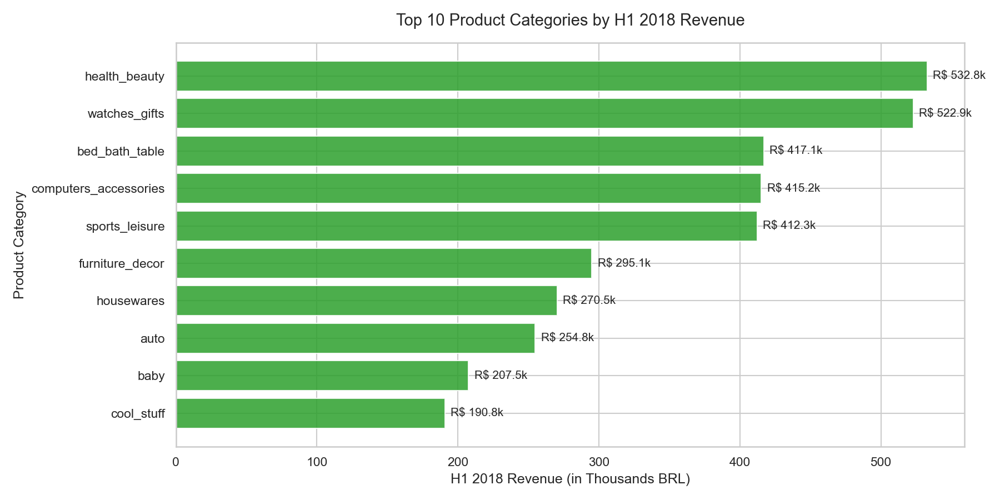
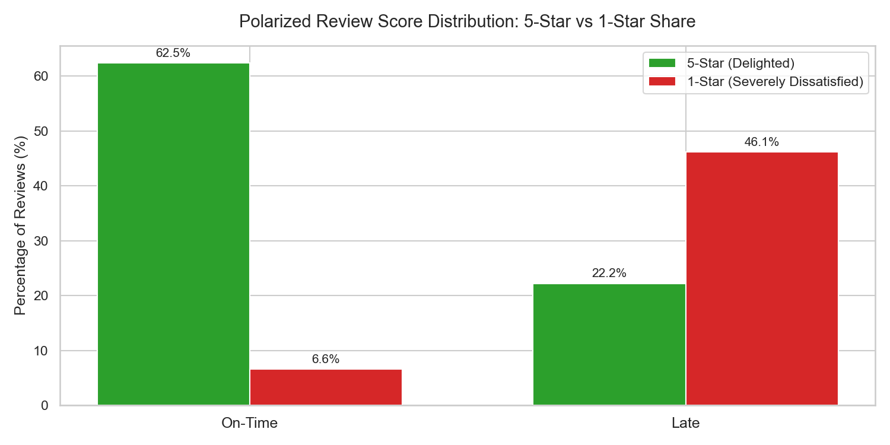
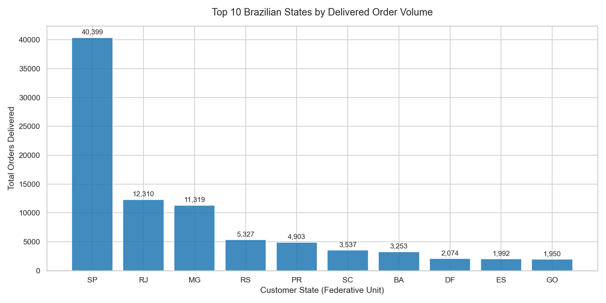
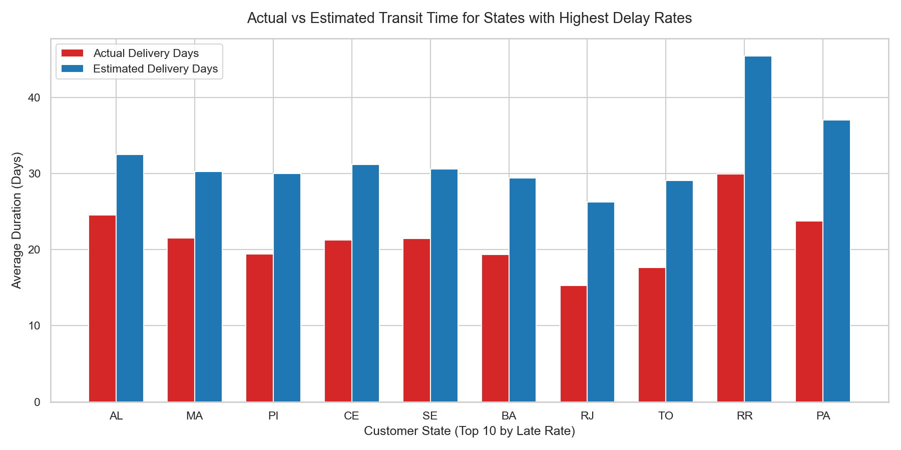

# Olist Brazilian E-Commerce Analysis: Growth Drivers, Customer Retention, and Logistics Optimization

> **Executive Headline:** Between 2017 and 2018, Olist grew monthly gross merchandise value (GMV) by over 5x (peaking at R$ 987.8k during Black Friday), yet repeat purchase rates remained stalled at **3.00%**. Meanwhile, delivery delays triggered a **40% collapse in review scores** (4.29 → 2.57 stars), and remote frontier states bore freight costs exceeding **59% of product value**. This analysis explores why top-line revenue scaled without repeat retention, and where logistics capital must go.

---

## 1. Executive Summary & Key Findings at a Glance

* **GMV Expansion with Heavy Seasonality:** Gross revenue totaled **R$ 13,181,027.13** across **96,211 delivered orders** (Jan 2017 – Aug 2018), peaking in November 2017 at **R$ 987,765.37** across 7,289 orders (+52.37% MoM).
* **The 30-Day Retention Window:** Repeat behavior is effectively a single-month phenomenon. Overall repeat rate is **3.00%** (2,789 repeat buyers out of 93,104 unique customers). Month 1 retention drops to **0.48%**; if a customer does not repurchase within 30 days of delivery, the probability they ever return drops below 0.3%.
* **The Late Delivery Rating Cliff:** On-time orders average **4.29 ★** (62.5% 5-star, 6.6% 1-star). When an order is late, ratings plunge to **2.57 ★** (-1.72 drop), with 1-star reviews surging to **46.15%**.
* **Regional Logistics Friction:** São Paulo (SP) boasts an average delivery duration of **8.74 days** and a **5.90% late rate**. In contrast, Alagoas (AL) suffers an average transit time of **24.52 days** and a **23.99% late rate**, while Roraima (RR) endures **29.91 days**.
* **Crushing Frontier Freight:** In São Paulo, shipping accounts for **26.51%** of product price. In remote states, freight burden reaches **51.53%** (PB), **55.06%** (MA), and **59.58%** (RO) of product price.
* **The Pareto Myth Busted ($x = 45.00\%$):** The top 20% of customers generate only **56.61%** of revenue (not 80%). Achieving 80% of revenue requires **45.00%** of all customers, disproving the viability of a traditional high-tier VIP loyalty program.

---

## 2. Business Problem & Objectives

This project addresses a fundamental strategic question:
> **"Which commercial factors drive revenue growth and repeat purchases on Olist, and where should retention and logistics investments go?"**

1. **Revenue Momentum & Seasonality:** What drove gross merchandise value, and which categories drove sustainable year-over-year gains?
2. **Customer Lifecycle & Retention:** Does Olist possess organic repeat buying, or is it fundamentally a single-transaction acquisition engine?
3. **Logistics Bottlenecks & Brand Equity:** How severely does late delivery penalize customer reviews, and which geographic regions suffer the highest delivery friction?
4. **Seller Operational Reliability:** Are delivery failures systemic across carrier networks or driven by a subset of chronic late-dispatch sellers?

---

## 3. Dataset Architecture & Grain Disambiguation

The project analyzes the public Brazilian E-Commerce dataset provided by Olist on Kaggle, encompassing real commercial records from 2016 to 2018.

* **Dataset Size:** 9 relational tables comprising ~99.4k orders, ~112.6k items, and ~96.1k unique human customers.
* **Grain & Entity Disambiguation:** 
  * `customer_id`: Unique identifier assigned per order (1:1 with transactions).
  * `customer_unique_id`: Persistent identifier tracking real individual human shoppers across multiple purchases.
* **Temporal Filtering & Data Cleaning Window:**
  * Raw orders span from September 2016 to October 2018.
  * **2016 Exclusion:** 2016 contains only ~329 pilot launch orders.
  * **September–October 2018 Exclusion:** Records after August 31, 2018 represent truncated reporting periods.
  * **Core Analytical Window:** Strictly bounded between **2017-01-01** and **2018-08-31** (`order_purchase_timestamp >= '2017-01-01' AND order_purchase_timestamp < '2018-09-01'`).
  * **Status Filtering:** All financial and operational performance metrics strictly filter for completed orders: `order_status = 'delivered'`.

---

## 4. Methodology & Analytics Stack

```
[9 Kaggle CSVs] ──> [Python ETL Loader] ──> [SQLite / Postgres DB] ──> [10 Analytical SQL Queries] ──> [Jupyter EDA] ──> [Power BI Star Schema]
```

1. **Database & SQL Engine (SQLite / PostgreSQL):**
   * Relational modeling and validation checks in [sql/validation.sql](./sql/validation.sql).
   * 10 production SQL queries in [sql/analysis.sql](./sql/analysis.sql) utilizing Common Table Expressions (CTEs), window functions (`LAG`, `DENSE_RANK`, running totals), and date arithmetic.
2. **Python Pipeline & EDA:**
   * Automated database ingestion via SQLAlchemy/Pandas in [scripts/load_olist.py](./scripts/load_olist.py).
   * Headless data extraction in [scripts/export_analysis.py](./scripts/export_analysis.py) and statistical visualization in [notebooks/eda.ipynb](./notebooks/eda.ipynb) (Matplotlib & Seaborn).
3. **Power BI Dashboard:**
   * Dimensional star schema model separating transaction grains from entity dimensions (documented in [POWER_BI_GUIDE.md](./POWER_BI_GUIDE.md)).

---

## 5. Visual Deep-Dive & Empirical Findings

### Finding 1: Seasonal Spike Driven by Black Friday with Category Concentration
Revenue surged from early 2017, reaching an all-time peak in November 2017 at **R$ 987,765.37** BRL across **7,289** orders (+**52.37%** MoM), before stabilizing around an average of **R$ 902,265.64** BRL per month in 2018. In H1 2018, the top revenue-generating categories were *Health & Beauty* (R$ 532.8k), *Watches & Gifts* (R$ 522.9k), *Bed, Bath & Table* (R$ 417.1k), and *Sports & Leisure* (R$ 397.6k), accounting for **34.25%** of gross sales.


*Figure 1: Monthly GMV (BRL) and order volume (Jan 2017 – Aug 2018).*


*Figure 2: Top 10 merchandise categories by H1 2018 revenue.*

---

### Finding 2: Retention Failure & The 30-Day Window
Repeat behavior is effectively a single-month phenomenon. The overall repeat purchase rate across the marketplace is only **3.00%** (**2,789** repeat buyers out of **93,104** unique human customers). Cohort retention analysis reveals that after Month 0, an average of only **0.48%** of customers return in Month 1, decay accelerates to 0.26% in Month 2, and drops below 0.2% by Month 6. If a customer is not reactivated within 30–45 days of delivery, they are virtually lost.


*Figure 3: Monthly customer cohort retention matrix (Month 1 peak average: 0.48%).*

---

### Finding 3: Catastrophic Review Impact from Late Deliveries
Delivery punctuality is the primary determinant of customer sentiment. On-time deliveries achieve an average review score of **4.29 ★** (**62.45%** 5-star ratings, 6.58% 1-star). When an order is delivered past the estimated delivery date, the average review score plummets to **2.57 ★** (-1.72 drop), with 1-star reviews surging to **46.15%**.


*Figure 4: Average customer review score: On-Time vs. Late delivery.*


*Figure 5: Rating breakdown showing massive surge in 1-star dissatisfaction for late orders.*

---

### Finding 4: Sharp Geographic Disparities in Shipping Performance
Logistics bottlenecks are concentrated outside the industrialized Southeast. While São Paulo (SP) boasts an average transit time of **8.74 days** and a low late rate of **5.90%**, remote states suffer severe friction: Alagoas (AL) suffers a late delivery rate of **23.99%** with an average delivery duration of **24.52 days**, while Roraima (RR) endures an average transit duration of **29.91 days**.


*Figure 6: Top 10 Brazilian states by delivered order volume (SP leads at 38.36%).*


*Figure 7: Actual vs estimated transit duration for states with the highest delay rates.*

---

### Finding 5: Crippling Freight Friction in Frontier Regions
Freight cost relative to product price reveals immense regional inequality. In São Paulo (SP), freight represents **26.51%** of item price. In contrast, remote states face average freight burdens ranging from **51.53%** (Paraíba - PB) to **55.06%** (Maranhão - MA) and **59.58%** (Rondônia - RO) of product price, creating a steep geographic barrier to entry.

---

### Finding 6: The Pareto Misconception (Debunking the 80/20 VIP Rule)
Contrary to traditional retail assumptions, Olist does **not** exhibit an 80/20 Pareto distribution. Cumulative revenue curve analysis indicates that the top 20% of customers account for only **56.61%** of total marketplace revenue. Reaching 80% of cumulative revenue requires **45.00%** of all customers. High customer churn and single-purchase behavior mean revenue is distributed broadly across a long tail of individual transactions.


*Figure 8: Customer cumulative revenue share curve (80% revenue reached at 45.0% of customers).*

---

## 6. Strategic Recommendations

### Recommendation 1: Argue AGAINST a "Top 20% VIP Loyalty Program"
* **Data-Driven Rationale:** Standard e-commerce playbooks advocate investing heavily in a "Top 20% VIP Loyalty Tier". The data directly refutes this strategy for Olist. Because the top 20% of shoppers generate only **56.61%** of revenue (and reaching 80% requires **45.00%** of shoppers), there is no entrenched cohort of high-frequency VIP buyers.
* **Alternative Action:** Redirect proposed loyalty budget away from VIP perks and into **automated post-purchase replenishment triggers** at 30, 60, and 90 days for consumable categories (*Health & Beauty*, *Pet Shop*, *Baby*), directly targeting the **30-day reactivation window**.

### Recommendation 2: Implement Regional Fulfillment Hubs (Fulfillment by Olist)
* **Action:** Establish regional consolidation and micro-fulfillment centers in the Northeast (e.g. Bahia or Pernambuco) to cut transit durations for remote consumers from **21–29 days** down to under 10 days.
* **Impact:** Halving delivery times in the Northeast directly curbs late delivery spikes (currently **23.99%** in AL), preventing marketplace review scores from tumbling off the **2.57-star** late delivery cliff.

### Recommendation 3: Enforce Seller Dispatch SLAs and Late Penalties
* **Action:** Institutionalize strict seller dispatch Service Level Agreements (SLAs). SQL query Q10 identifies sellers with >= 50 completed orders who maintain chronic late dispatch rates reaching up to **32.10%** with average delays exceeding **28 to 40 days** (e.g. seller `54965bbe3e4f07ae045b90b0b8541f52` in PR).
* **Impact:** Penalize or temporarily delist chronic repeat offenders. Marketplace algorithms should prioritize Buy Box exposure for sellers maintaining <5% late delivery rates.

---

## 7. Analytical Limitations

1. **Correlation vs. Causation:** The strong correlation between late delivery and 1-star reviews may also be influenced by underlying product defect rates, packaging damage, or seller communication.
2. **Lack of Marketing & Customer Acquisition Cost (CAC) Data:** The dataset lacks paid media spend and conversion funnels, precluding direct calculation of Customer Lifetime Value to CAC ratios (LTV:CAC).
3. **Conditionality of Reviews:** Over 99% of customer reviews correspond to delivered orders. Feedback from canceled or unavailable orders before shipment is underrepresented.
4. **Truncated Data Boundaries:** Analysis is restricted to Jan 2017 – Aug 2018 due to incomplete telemetry in late 2018.

---

## 8. Dashboard & Data Modeling Architecture

The project features a complete Star Schema design implemented for Power BI Desktop, fully documented in [POWER_BI_GUIDE.md](./POWER_BI_GUIDE.md):

```
        ┌────────────────┐       ┌─────────────────┐
        │  Dim_Customers │       │    Dim_Date     │
        └───────┬────────┘       └────────┬────────┘
        1       │                         │ 1
                │ customer_id             │ Date (to order_purchase_timestamp)
                ▼                         ▼
            ┌───────────────────────────────────┐
            │            Fact_Sales             │
            └───────▲───────────────────▲───────┘
          product_id│                  seller_id
                    │ 1                         │ 1
        ┌───────────┴────┐       ┌──────────────┴──┐
        │  Dim_Products  │       │   Dim_Sellers   │
        └────────────────┘       └─────────────────┘
```

* **Core Fact Table (`Fact_Sales`):** Model at the `order_item` grain (`price`, `freight_value`, `order_status = 'delivered'`).
* **12 Production DAX Measures:** Includes Total Revenue, AOV, MoM Growth %, Late Orders %, Avg Delivery Days, and Repeat Rate %.
* **Step-by-Step Implementation:** See [POWER_BI_GUIDE.md](./POWER_BI_GUIDE.md) for data modeling, DAX code, and visual layout guides.

---

## 9. Repository Structure & How to Run

```
olist-ecommerce-analysis/
├── README.md                      # Executive findings, methodology, and recommendations
├── INTERVIEW_PREP.md              # 10 spoken interview Q&As with real metrics
├── POWER_BI_GUIDE.md              # Step-by-step Power BI dashboard manual
├── SETUP.md                       # Comprehensive setup commands and DAX library
├── requirements.txt               # Python package dependencies
├── .gitignore                     # Git ignore rules for raw data, DBs, and secrets
├── .env.example                   # Environment variable template
├── scripts/
│   ├── load_olist.py              # Automated data ingestion into PostgreSQL / SQLite
│   ├── export_analysis.py         # Executes 10 SQL queries and exports CSVs to data/processed/
│   └── execute_notebook.py        # Headless executor for Jupyter EDA notebook
├── sql/
│   ├── validation.sql             # Row-count checks and data quality audit queries
│   └── analysis.sql               # 10 core analytical queries (CTEs, Window functions)
├── notebooks/
│   └── eda.ipynb                  # 12-cell executed Jupyter notebook with outputs
├── data/
│   ├── raw/                       # 9 raw Kaggle CSVs (git-ignored)
│   └── processed/                 # 10 exported query outputs (monthly_revenue.csv, etc.)
└── dashboard/
    └── screenshots/               # 8 exported figures (01_monthly_revenue.png, etc.)
```

### Quickstart Execution
```bash
# 1. Install dependencies
pip install -r requirements.txt

# 2. Ingest raw CSV datasets into SQLite
python scripts/load_olist.py

# 3. Execute analytical queries and export 10 CSVs
python scripts/export_analysis.py

# 4. Run EDA notebook and generate visual screenshots
python scripts/execute_notebook.py
```
