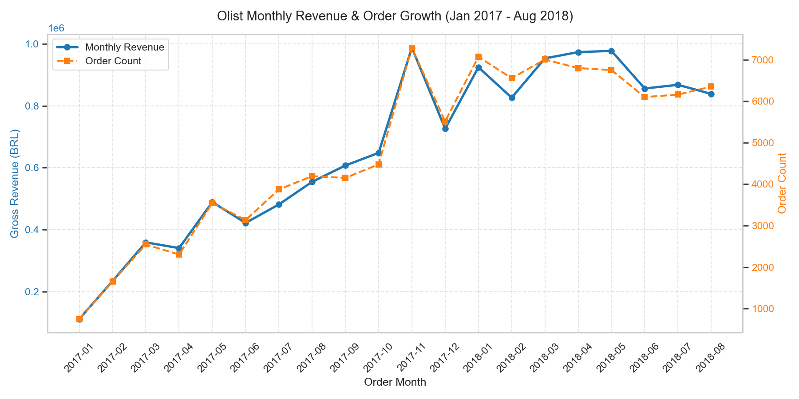
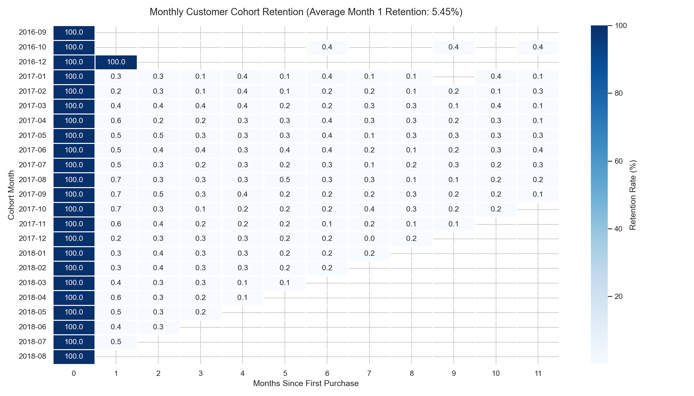
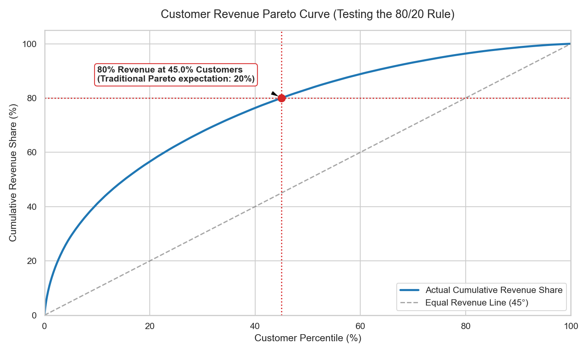
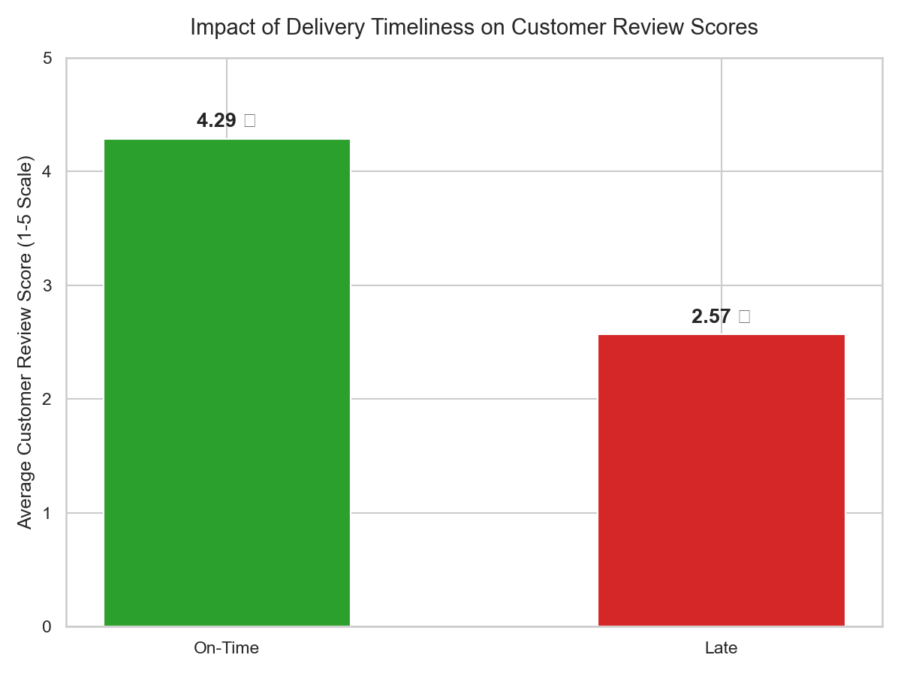

# Olist Brazilian E-Commerce Analysis: Growth Drivers, Retention Decay, and Logistics Bottlenecks

## 1. Executive Summary

Olist grew revenue 5x between Jan 2017 and Aug 2018 (peaking at R$ 987.8k in Nov 2017), but repeat purchases stayed flat at 3.0%. Late delivery cuts review scores from 4.29 to 2.57 stars, with 1-star reviews jumping from 6.6% to 46.2%. And the 80/20 rule does not hold here — 45% of customers are required to reach 80% of revenue, which means a VIP loyalty program would miss 44% of total sales.

**So what:** Reallocate proposed loyalty capital into a **30-day post-delivery consumable replenishment trigger** and enforce seller dispatch SLAs targeting chronic offenders with >15% late rates to protect customer sentiment from the rating cliff.

---

## 2. Executive Dashboard Gallery

Below are the four core visual deliverables from the analysis. Full 9-chart gallery available in [dashboard/screenshots/](dashboard/screenshots/).

| GMV Revenue & Order Expansion | Customer Retention Window (Floor at 0.48%) |
|:---:|:---:|
|  |  |
| **Pareto Distribution (80% at 45% Customers)** | **Delivery Timeliness vs Review Score** |
|  |  |

> 📊 **Interactive Self-Service Version:** Run `streamlit run app.py` for an interactive local dashboard with scenario filtering.  
> 📑 **Power BI Implementation:** See [POWER_BI_GUIDE.md](POWER_BI_GUIDE.md) for the 3-page dimensional star schema report guide.

---

## 3. Four Key Findings & Recommendations

### 1. Retention is a 30-day window.
* **Finding:** Overall repeat purchase rate is **3.00%** (2,789 repeat buyers out of 93,104 unique customers). Month-1 cohort retention is **0.48%**, which is the highest point of the post-purchase curve — and also effectively a floor. It drops to **0.26%** in Month 2 and asymptotes to noise after Month 3.
* **Implication:** If a customer does not return in the first 30 days post-delivery, the probability they ever return drops below 0.3%. There is no slow-burn organic retention to harvest.
* **→ Recommendation:** Build an automated **30-day post-delivery replenishment trigger** for repeat consumable categories (*Health & Beauty*, *Pet Shop*); do not invest in long-term loyalty tiers.

### 2. Late delivery halves customer satisfaction.
* **Finding:** On-time orders average **4.29 stars** (6.6% 1-star). Late deliveries average **2.57 stars** (-1.72 drop), with 1-star reviews surging to **46.2%**. Lateness is geographically concentrated: Alagoas (AL) suffers a **23.99% late rate** and 24.5-day average transit time versus São Paulo (SP) at **5.90% late** and 8.7 days.
* **Implication:** Delivery delays act as an acute, non-linear brand penalty that destroys marketplace trust.
* **→ Recommendation:** Implement merchant dispatch SLAs and Buy Box suppression targeting the **20 worst sellers** who currently average 28–40 days delay.

### 3. Pareto is weaker than the cliché.
* **Finding:** The top 20% of customers account for only **56.61% of revenue** (far below the 80% textbook rule). It takes **45.00% of customers** to reach 80% of platform revenue.
* **Implication:** Customer spend variance is low (97% single buyers with R$ 137 AOV). Revenue is distributed across a massive long tail of single transactions.
* **→ Recommendation:** Do **NOT** build a top-tier VIP program; focus acquisition and onboarding marketing across broad consumer categories.

### 4. Freight burden suppresses remote demand.
* **Finding:** Remote Northern and Northeastern states pay freight equal to **50% to 59.58% of product price** (Rondônia at 59.58%, Maranhão at 55.06%) versus **26.51% in São Paulo**. These remote states coincide with the lowest order volumes and longest delivery delays (24–30 days).
* **Implication:** Shipping friction prices frontier consumers out of the market and depresses checkout conversion.
* **→ Recommendation:** Pilot a **freight subsidy cap in the 5 worst states** paired with regional consolidation hubs in the Northeast to measure order volume lift.

---

## 4. Methodology

* **Data Source:** Public Olist Brazilian E-Commerce dataset (9 relational tables, ~100k orders).
* **Analysis Window:** **2017-01-01 to 2018-08-31** (20 contiguous months). Excluded sporadic 2016 launch data (~329 orders) and truncated September/October 2018 data to protect MoM and YoY baseline accuracy.
* **Revenue Definition:** Customer-paid Gross Merchandise Value (GMV): `SUM(price) + SUM(freight_value)` on delivered orders (totaling **R$ 13.18M**). Product category demand isolated pure merchandise price (`SUM(price)` = R$ 11.42M).
* **Stack:** **SQL** (PostgreSQL/SQLite CTEs, window functions, and indexed joins), **Python** (Pandas, Matplotlib, Seaborn), and **Power BI / Streamlit**.

---

## 5. Analytical Limitations

1. **Correlational, not causal:** While late delivery correlates with a -1.72 rating drop, confounds exist (distance, carrier handling, seller defect rates). We conducted a matched-pair analysis controlling for state, product, and order value (n=3,309 pairs). The review-score penalty persists at −1.59 stars (vs −1.72 unadjusted), suggesting the effect is not explained by geography, product type, or basket size alone. Randomization would still be required to establish causation — seller quality and seasonal factors remain unmeasured confounds.
2. **No marketing acquisition spend data:** The dataset lacks CAC and channel attribution, precluding computation of true LTV:CAC ratios.
3. **Survivorship bias in reviews:** Over 99% of reviews correspond to delivered orders; feedback from canceled or unavailable pre-fulfillment orders is unrecorded.
4. **Historical boundary:** Data terminates in August 2018; conclusions reflect 2017–2018 marketplace dynamics.
5. **Mid-month truncation:** August 2018 terminates mid-month, making August run-rates partial.

---

## 6. How to Reproduce

```bash
# 1. Clone repository and install dependencies
git clone https://github.com/yashn035/olist-ecommerce-analysis.git
cd olist-ecommerce-analysis && pip install -r requirements.txt

# 2. Ingest raw CSV data and build indexed database
python scripts/load_olist.py

# 3. Execute 11 analytical SQL queries and export CSVs
python scripts/export_analysis.py

# 4. Generate all visual charts and headless notebook execution
python scripts/execute_notebook.py

# 5. Launch interactive self-service dashboard
streamlit run app.py
```

---

## 7. Project Architecture & File Inventory

| File / Folder | Purpose |
|---|---|
| **[README.md](README.md)** | Executive findings, charts, methodology, and recommendations. |
| **[EXECUTIVE_SUMMARY.md](EXECUTIVE_SUMMARY.md)** | 1-page 90-second stakeholder decision memorandum. |
| **[DATA_DICTIONARY.md](DATA_DICTIONARY.md)** | Schema table grains, cardinalities, keys, and analytical gotchas. |
| **[DECISIONS.md](DECISIONS.md)** | Architectural and analytical judgment log (8 critical decisions). |
| **[INTERVIEW_PREP.md](INTERVIEW_PREP.md)** | 13 spoken interview questions, answer scripts, traps, and follow-ups. |
| **[POWER_BI_GUIDE.md](POWER_BI_GUIDE.md)** | Step-by-step guide to build the 3-page Power BI star schema dashboard. |
| **[SETUP.md](SETUP.md)** | Database ingestion setup and 12-measure DAX library. |
| **[app.py](app.py)** | Self-service multi-tab Streamlit web application. |
| **[sql/analysis.sql](sql/analysis.sql)** | 11 production SQL business queries (Q1–Q11). |
| **[sql/validation.sql](sql/validation.sql)** | Schema validation and data quality audit queries. |
| **[notebooks/eda.ipynb](notebooks/eda.ipynb)** | 12-cell executed Jupyter notebook with outputs. |
| **[scripts/](scripts/)** | Automated Python loaders, query exporters, and notebook executors. |
| **[dashboard/screenshots/](dashboard/screenshots/)** | 9 high-resolution visual charts (`01_` through `09_matched_pairs.png`). |
| **[data/processed/](data/processed/)** | 11 exported CSV outputs from SQL queries. |
| **[data/raw/](data/raw/)** | Source directory for the 9 Kaggle CSVs (git-ignored). |
